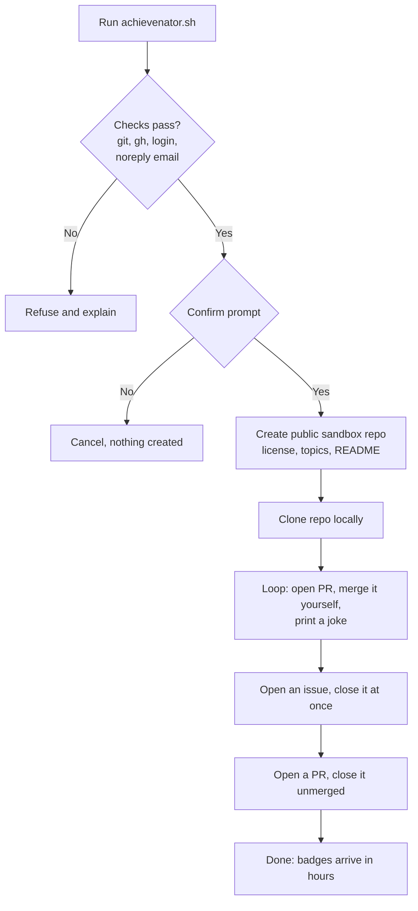

````text
                         .
                        /|
                       / |
                      /  |
                     /   |
             _____.-'    `-.______
      _.---''                      ``--..__
   ,-'                                      ``-._
  /  o                                           `-.      /|
 <       ,                                          `-.__/ |
  \    ,/ \     ///                                         |
   `-._\/\/\/\/\.__                                    __.-'|
       ``--.._     ``--.._____..-.._____.-----...--''''     \
              ``--..__                         __..--''`.    \
                      ```----------------'''''          `-.__|

          A C H I E V E N A T O R
````

# Achievenator

**Version:** `v2026.11.04.1453` · **By** Scott McQueen

> A cheeky bash script that unlocks the easy GitHub achievements (Pull Shark, YOLO, Quickdraw) in a sandbox repo of your own.


## Overview

Achievenator creates a small public sandbox repo under your account, then opens and merges a batch of pull requests and opens and closes an issue and a PR in quick succession. That is enough to earn three profile badges without waiting for the real thing. It only touches the repo it creates, and it deliberately skips every badge that would need other people or fake accounts.

## How it works



## Badges

| Badge | How it is earned here |
| --- | --- |
| Pull Shark | Merged pull requests (16 by default, the second tier) |
| YOLO | Merging your own pull request with no review |
| Quickdraw | Closing an issue or pull request within five minutes of opening |

Skipped on purpose: Starstruck, Galaxy Brain, Heart On Your Sleeve, Open Sourcerer (they need other people), Pair Extraordinaire (needs a real co-author), Arctic Code Vault and Mars 2020 (historical), Public Sponsor (costs money).

## Requirements

- `git`
- `gh`, logged in (`gh auth login`)
- A GitHub noreply commit email (`git config --global user.email`), because GitHub blocks pushes that expose a private email
- Optional: commit signing, in which case the commits it makes will be signed

## Usage

```bash
chmod +x achievenator.sh
./achievenator.sh [repo-name] [merged-pr-count]

# defaults: achievements-sandbox, 16 PRs (maximum 32)
./achievenator.sh achievements-sandbox 16
```

The script asks for confirmation before creating anything.

## Things to know

- The sandbox repo is **public**, because GitHub ignores private repos for achievements.
- Keep the repo afterwards. Deleting it can remove the activity the badges rest on.
- Badges usually appear within a few hours, sometimes a day.
- Run it once. It is a joke with a shark in it, not a content farm.

## Project structure

```text
achievenator/
├── achievenator.sh   # the script
├── LICENSE
└── README.md
```

## License

Released under the MIT license. See [LICENSE](LICENSE) for details.

## Author

Scott McQueen, [@scottmcqueen](https://github.com/scottmcqueen)
